# PawCare — ERD and Application Flowcharts

9 November 2026 · Logical design, implemented 23 November 2026 (see Implementation status) · Source: Notion "PawCare_ERD_and_Flows"

> Review notes, gaps and spec conflicts: see `docs/design/erd-review.md`. Where this design and the spec disagree, the spec wins until the decision is logged in `docs/decisions.md`.

This logical design was derived from the tickets. It is implemented as the baseline migration in SETUP-01 (`apps/api/prisma/schema.prisma` and `apps/api/prisma/migrations/`). See **Implementation status** below for how the implemented schema differs from the original Notion page. Authentication is a prerequisite and its credential/session schema is intentionally outside the detailed diagrams.

## Implementation status (23 November 2026)

The diagrams below were updated to match the implemented schema and the decisions in `docs/decisions.md`. Where the implemented schema goes further than a diagram, `schema.prisma` and the migration SQL are authoritative.

| Topic | Original design | Implemented |
| --- | --- | --- |
| IDs (D-ERD-4) | Sequential `bigInt` | UUIDv7 for every ID, generated in the database by `uuidv7()` |
| Same-owner integrity | Composite FKs "where practical" | Every owner table has `owner_id`; every FK between owner tables includes it; no cascades |
| Care subtypes | "constraints/triggers or equivalent" | Subtypes carry `owner_id`, `pet_id` and a constant `kind`, and reference `CARE_RECORDS(owner_id, pet_id, id, kind)`; a deferred trigger requires the subtype by commit |
| Vaccine fulfillment (D-ERD-3) | Many due items per administration | One administration fulfills at most one due item (unique FK) |
| Prescription zone (D-ERD-1) | Fixed per-prescription `time_zone` | `follows_owner_zone` (default true); `time_zone` holds the effective zone |
| Attachments (review item 5) | Row created after a clean scan | Row created when the upload starts; `FILE_ASSETS.scan_status` covers PENDING_UPLOAD, SCANNING, CLEAN, REJECTED, FAILED; `purpose` limits profile images to JPEG/PNG |
| Dose duplicates (review item 6) | UNIQUE per schedule version only | Also at most one non-invalidated occurrence per prescription and instant |
| Stock idempotency (review item 7) | Global `request_id` | `owner_id` + UNIQUE(owner_id, request_key) |
| Stock ledger | Immutable, balance is a cache | Triggers block ledger updates and check each batch balance equals its entries at commit |
| Appointment outcome (review item 10) | `outcome_recorded_at` only | Adds `outcome_actor_id` |
| Device tokens | Token globally unique | Unique among enabled rows; a new owner gets a new row, so deliveries can't cross owners |
| Audit events | — | Append-only (trigger); the actor becomes NULL on account erasure |

Rules that stay in the API: attachment limit of five per record, discrete-unit whole quantities, medical events link only Completed appointments, due date not before administration, fixed-daily schedules need at least one time, and every lifecycle/eligibility rule in the flows below.

Only pet owners use the application. Provider names and contact details are owner-entered text. There are no clinic users, appointment slots, booking approvals, or clinic notifications. The application requires connectivity in v1.

## Reading the diagrams

`PK` = primary key; `FK` = foreign key; `UK` = unique key. A circle means optional, a bar means one, and a crow's foot means many. Attributes marked nullable are optional. Repeated entities connect the sections; they are the same tables, not duplicates. UUID and timestamp types are logical types to map to the chosen database.

All mutable owner records have created_at, updated_at, and version fields unless explicitly immutable. Care facts use owner-entered provenance. Dates remain date-only; event instants use UTC plus an IANA time zone. Server time controls eligibility.

## 1. Ownership and health records ERD

Coverage: FN-01, PF-01–PF-04, MR-01–MR-04.

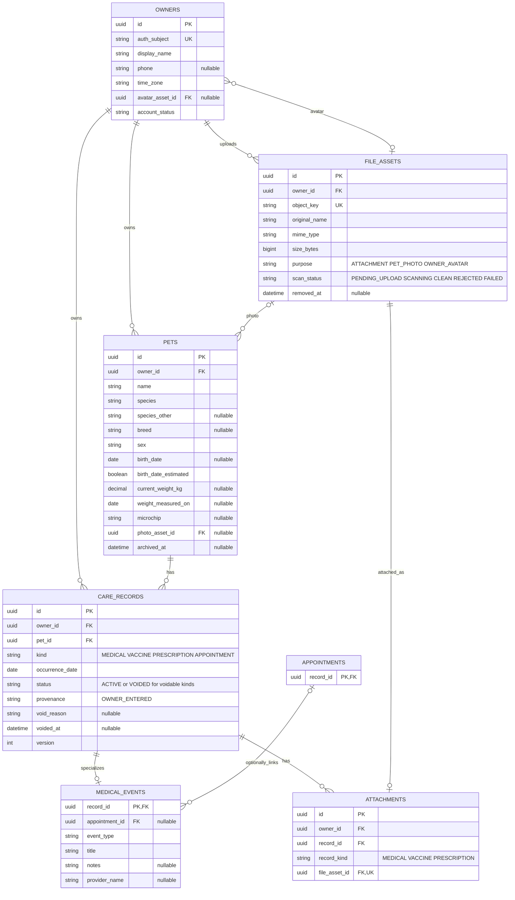

**Design choice:** CARE_RECORDS is a shared parent for all four health/appointment kinds. Each has exactly one matching subtype row, created in the same transaction. The subtype constraint cannot be fully expressed by the optional Mermaid subtype edges: enforce one matching subtype and prohibit mismatched kinds through database constraints/triggers or equivalent transactional rules. Parent status controls voiding; appointment lifecycle is separate below. Appointment records are not voided in v1.

Use FILE_ASSETS for both images and medical uploads. ATTACHMENTS may target only medical, vaccine, or prescription kinds; at most five files per care record. Profile images require image MIME types and the same validation/scanning pipeline. A removed asset is never reused for a new attachment. Authorize asset ownership before issuing a short-lived URL.

**Timeline is a query/view, not a second history table:** combine non-voided medical/vaccine/prescription records and owner-completed appointments. Include voided entries only when explicitly requested. Link to canonical subtype details. Use source kind plus ID as the stable identity. The displayed occurrence date is administration date, prescription start, medical date, or appointment local start date. Linked clinical notes remain distinct medical events, not duplicated appointment items.

## 2. Vaccines, prescriptions, and appointment ERD

Coverage: VC-01–VC-04, AP-01–AP-05.

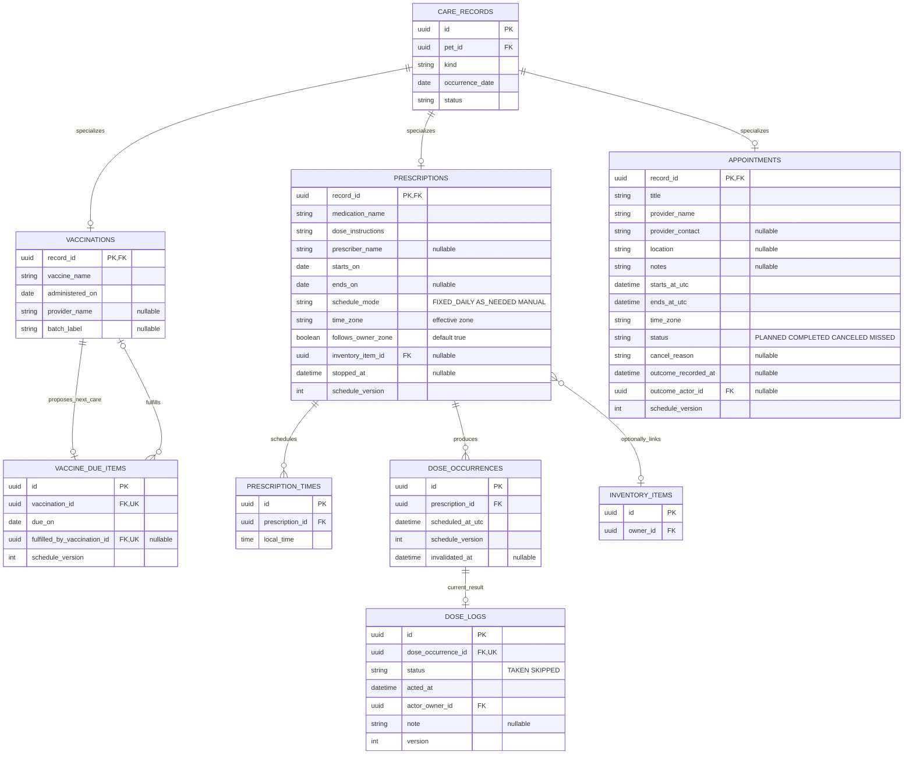

### Care constraints

- A due item is created only when a vaccine next date is supplied; due date cannot precede administration. One next due item per administration; the fulfillment link must point to a different, non-voided vaccination for the same owner and pet. Do not infer fulfillment from matching names. One administration fulfills at most one due item (D-ERD-3), always through an explicit selection.
- Voiding a fulfilling vaccination reopens the item it fulfilled (clear the fulfillment link in the same transaction). Voiding the source vaccination suppresses its pending due alerts. Due/overdue/fulfilled are derived from date, fulfillment, and source validity rather than independent editable flags.
- Prescription local times are unique within a prescription. AS_NEEDED and MANUAL have no generated daily dose occurrences. Fixed-daily schedules require at least one local time. End date is inclusive in the prescription's zone; starts_on <= ends_on. The zone follows the owner zone unless follows_owner_zone is false (D-ERD-1); on a confirmed owner-zone change, bump schedule_version and regenerate future occurrences.
- UNIQUE(prescription_id, schedule_version, scheduled_at_utc) prevents duplicate dose generation, and at most one non-invalidated occurrence may exist per prescription and instant, so regeneration skips instants already logged under an older version. A dose log has at most one current result; corrections are captured in AUDIT_EVENTS. Stopping or voiding a prescription invalidates unlogged future occurrences and future reminders, while preserving history.
- A dose status is not stored as Overdue. Compute overdue from scheduled instant, current log, prescription lifecycle, and invalidation. Dose Taken never deducts inventory.
- Appointment end must follow start by 1–480 minutes. New appointment starts are future instants. Edits to a Planned past visit may keep its time when only descriptive fields change; moving the visit requires a new future instant. Pet association is immutable after creation.
- Needs Update is a view condition: status=PLANNED and start <= server now. Terminal statuses are read-only in v1. Same-pet overlaps cause a warning requiring explicit confirmation, not a slot reservation constraint.

## 3. Household inventory ERD

Coverage: IN-01–IN-04; optional prescription links in VC-02.

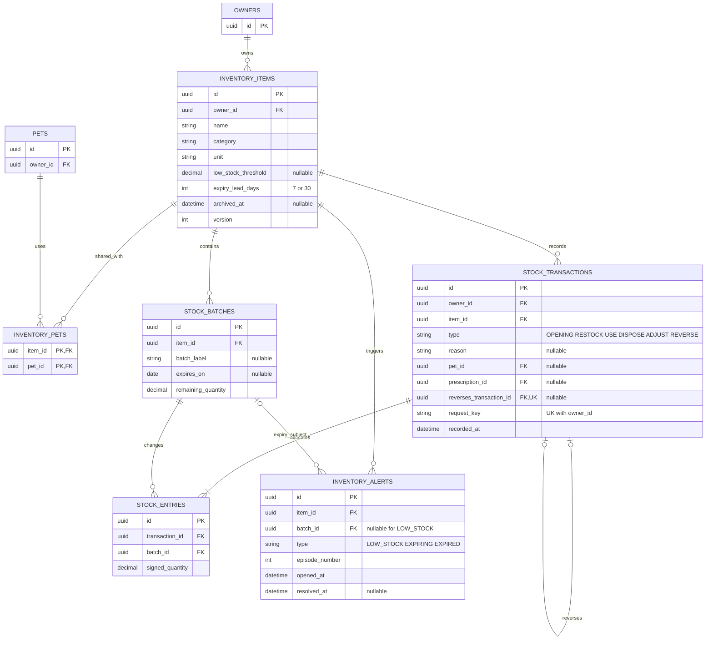

### Inventory constraints

- Household ownership belongs to OWNERS, not a single pet. INVENTORY_PETS supports many pets per item and many items per pet. Enforce same owner across the join and optional transaction references.
- Store fixed decimals with three fractional digits; require whole quantities for piece/tablet/capsule/sachet. The item unit becomes immutable after any transaction. Never convert dose text or package size automatically.
- STOCK_ENTRIES is the immutable batch ledger. A single consumption can allocate across multiple batches. Batch balance is a transactional cache equal to its entries' sum; lock affected rows before validation and update all ledger/balance rows atomically. No batch may become negative.
- OPENING/RESTOCK adds stock, USE/DISPOSE subtracts, ADJUST may have either sign, and REVERSE negates every entry in its original transaction. A reversal must be complete, at most once, same item, and leave all batch balances valid. Otherwise require an explicit adjustment.
- Proposed zero-opening implementation: create the item and a zero-balance opening batch/entry atomically, permitting signed_quantity=0 only for OPENING. All use/restock/disposal quantities must be positive in the request.
- Physical quantity sums every batch; usable quantity excludes expired batches. Unknown expiry counts as usable but is visibly Unknown. A batch expires at the start of the day after expires_on in owner time. Default consumption uses earliest dated expiry, then unknown expiry; expiry never removes physical stock automatically.
- LOW_STOCK has no batch_id and one open episode per item. Resolve when usable quantity rises above threshold; future drops create a new episode. EXPIRING/EXPIRED requires a batch belonging to the same item, with one alert per batch/type. Re-evaluate alert eligibility after edits, disposal, and date/time-zone changes. Archive only at zero physical balance and cancel its pending alerts.

## 4. Reminders and delivery ERD

Coverage: RM-01–RM-04 and all source integrations.

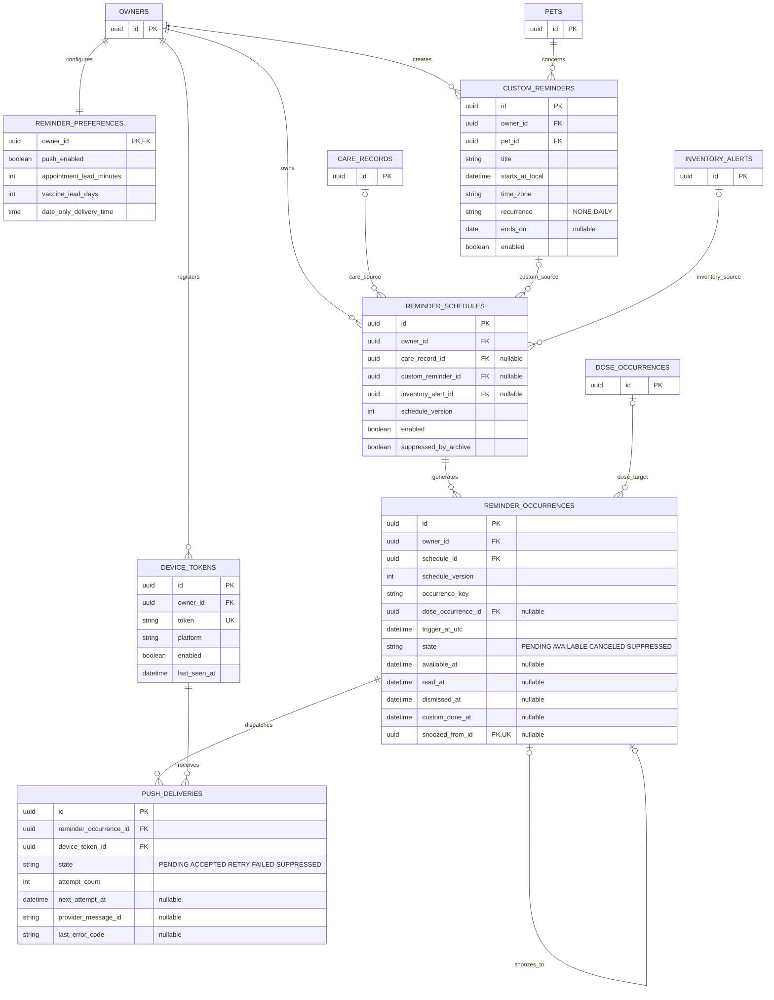

### Reminder constraints

- Exactly one source FK is non-null on REMINDER_SCHEDULES. Care sources are vaccines, prescriptions, or appointments only; general medical events do not generate automatic alerts. A vaccine schedule resolves to its single due item. Use typed foreign keys and a CHECK constraint instead of an unenforced source_type/source_id pair.
- Source schedules are versioned when source timing changes, preferences change, or owner-local timezone rules change. Old pending occurrences are invalidated. UNIQUE(schedule_id, schedule_version, occurrence_key) provides canonical in-app deduplication. One active schedule per source. Preserve old schedule versions on occurrences.
- A prescription reminder occurrence references the exact DOSE_OCCURRENCE it concerns. Vaccines/custom reminders/appointments/inventory leave dose_occurrence_id null. Validate that the target belongs to that schedule's prescription and owner.
- The occurrence is also the in-app inbox item; create no duplicate notifications table. read_at is independent of dismissed_at and custom_done_at. Medication and vaccine completion live in their care tables. An already delivered item can remain in history after its source is invalidated, but its action must re-check eligibility.
- UNIQUE(reminder_occurrence_id, device_token_id) deduplicates push delivery per active device. Retry the same delivery row after 1, 5, and 15 minutes. Provider acceptance is not proof of delivery or a completed care task. Failed push does not remove the in-app item.
- A snooze creates one follow-up occurrence 15 minutes later, linked by unique snoozed_from_id. Re-snoozing a follow-up may form a chain, but no occurrence has multiple follow-ups. Do not snooze past appointment start, next dose time, or source eligibility.
- Date-only/vaccine alerts use owner zone and configured time; prescription daily times follow their schedule zone. On a confirmed owner-zone change, regenerate future owner-local schedules. Appointment instants remain unchanged. Handle spring gaps at next valid local time and repeated times once at the first instant, as specified in RM-01.
- When a token is associated with a newly signed-in account, revoke its former owner association and pending deliveries atomically. Disable tokens on logout or provider invalid-token responses. Never send owner A's reminders through a token currently belonging to owner B.

## 5. Reliability and deletion support ERD

Coverage: FN-01/FN-02 and shared mutation/delivery requirements. These are proposed supporting tables, not additional user features.

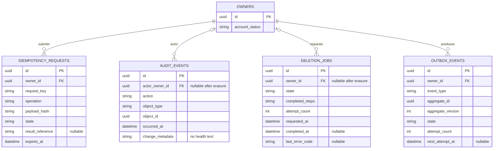

UNIQUE(owner_id, operation, request_key); reject key reuse with different payload. Commit resource mutation and its outbox record together. Consumers must remain idempotent. Audit object references are intentional historical identifiers, not live resource FKs. Do not retain health text, secrets, or signed URLs in operational metadata. Deletion jobs/audits may retain only approved anonymized operational evidence after account erasure. The deletion retention policy and completion target remain a release gate from FN-02; this design does not invent them.

## 6. Main owner journey

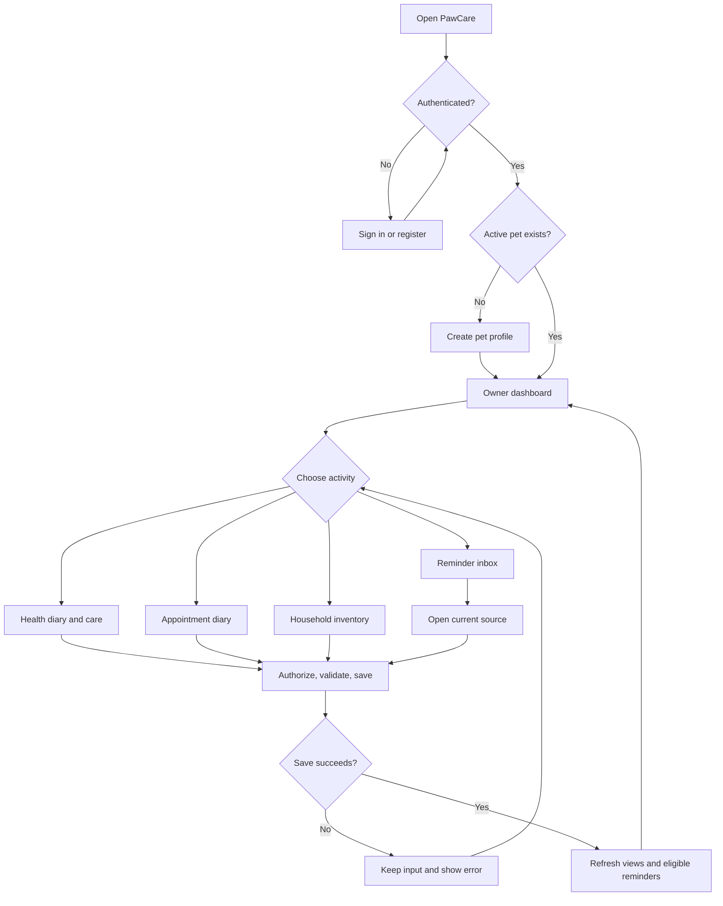

The initial pet route prepares pet-specific care. Inventory remains household-level. Switching pets while a care form is unsaved requires discard confirmation or remaining on the current pet. Every source action checks current ownership, lifecycle, and version on the server.

## 7. Medical entry and document upload

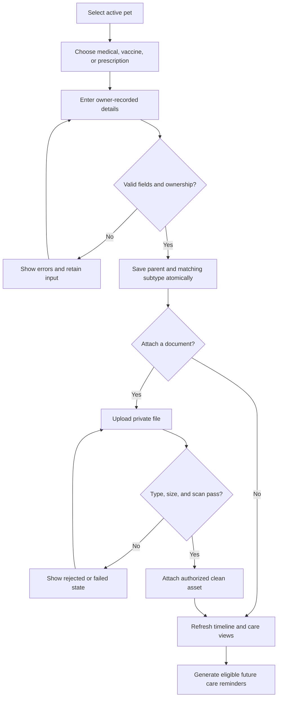

The saved record remains valid if its optional attachment fails. Upload failures offer retry or removal; scanning assets are not downloadable. Voiding a care source preserves its history, excludes it from active care summaries, and cancels pending reminders. Vaccine fulfillment is explicit and atomic with the new administration.

## 8. Appointment diary lifecycle

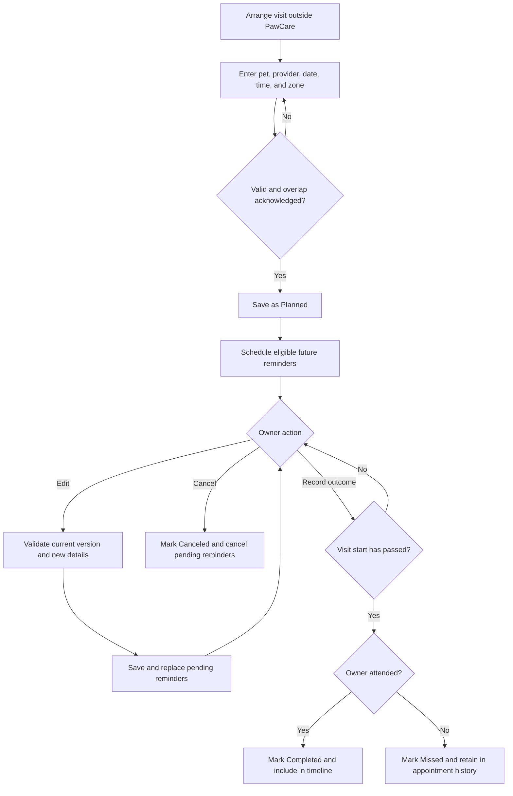

Elapsed time alone leaves the visit Planned and places it in Needs Update. Outcomes are owner-reported. Cancel/edit changes the diary only and must say so. Terminal entries are read-only; Completed/Missed/Canceled cancel future alerts. No provider interaction occurs anywhere in this flow.

## 9. Medication tracking and inventory separation

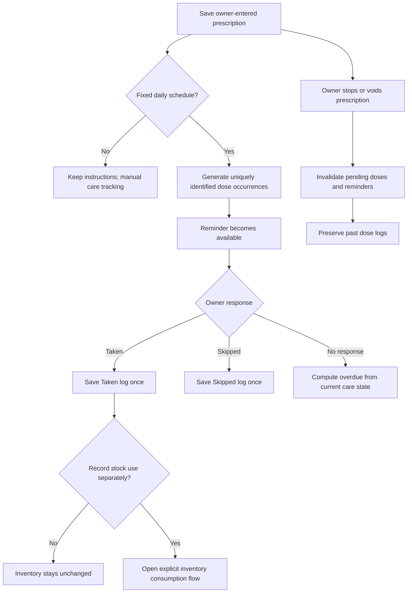

Snoozing, reading, or receiving a reminder does not mark a dose Taken. An inventory link identifies a supply item only; it does not convert prescription instructions into a stock quantity. Stopping is effective no later than server now and never deletes prior logs.

## 10. Reminder generation and delivery

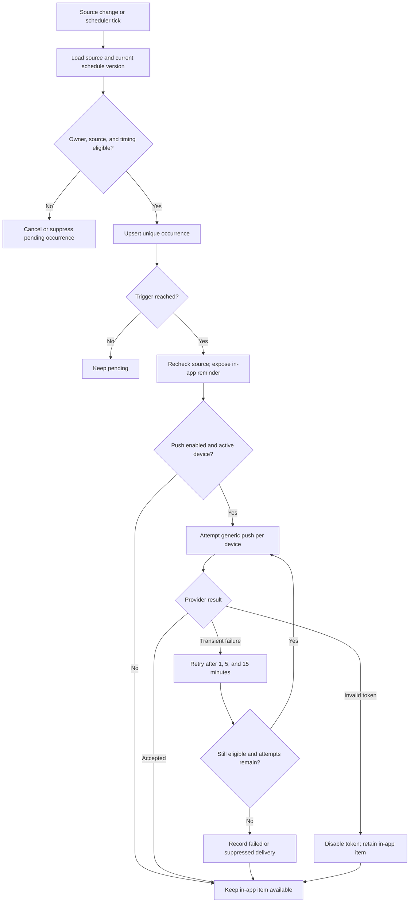

The check at dispatch can suppress an obsolete item even if the earlier eligibility check passed. For outage recovery, only still-actionable triggers at most 24 hours late may alert, and must be labeled delayed; never alert after an appointment starts or a subsequent dose becomes due. Newly entered overdue sources do not replay historical alerts. Push acceptance is not guaranteed receipt; ambiguous provider responses can cause OS-level duplicates even when the inbox remains deduplicated.

## 11. Inventory transaction flow

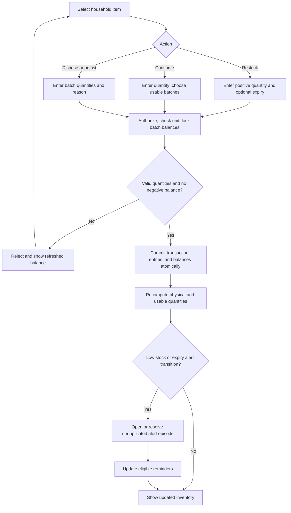

Stock checks also run on date rollover for expiry-driven changes. Expired batches remain physical stock and can be disposed; they cannot be consumed as usable stock. Reversals are compensating transactions and must pass the same nonnegative-balance validation.

## 12. Pet archive and restoration

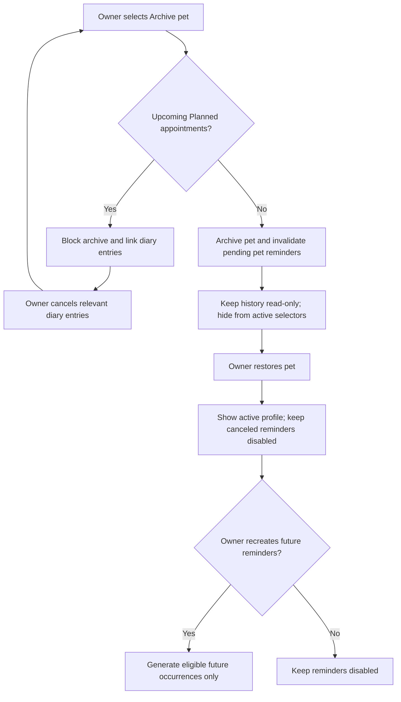

Serialize archive and appointment creation checks. Household stock is never deleted when a linked pet is archived. Preserve a scheduling-suppression flag/version when archiving so an ordinary scheduler tick cannot recreate canceled pet reminders after restoration; only explicit owner re-enablement clears it. Store that flag on the relevant source schedules or a pet reminder policy, rather than relying solely on deletion of occurrences.

## 13. Account deletion

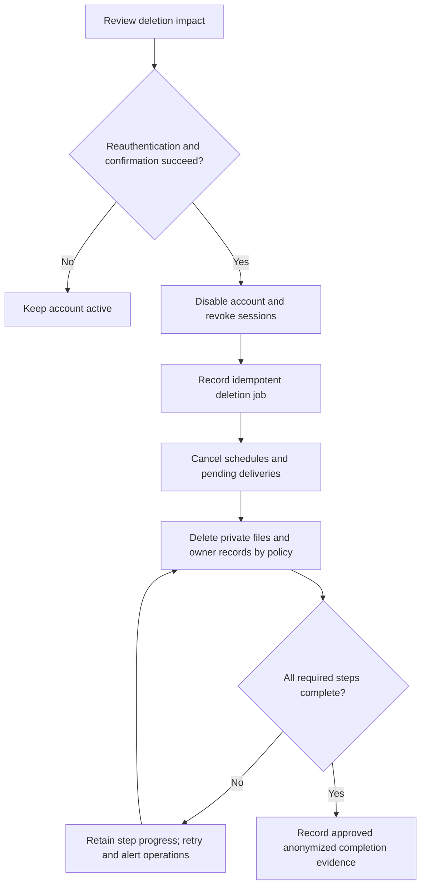

Disable writes before cleanup begins. Deletion must cover files, device tokens, dose data, inventory ledgers, inbox items, attachments, outbox payloads, and account identifiers, in FK-safe order. Retry failed steps without restarting completed work. Backup handling and any audit retention are governed by the still-required approved policy.

## 14. Ticket-to-model traceability

| Ticket group | Main tables or derived views | Flow |
| --- | --- | --- |
| FN-01 | Owner boundaries across every resource; device tokens and file assets | All flows |
| FN-02 | Deletion jobs; account state; cleanup across all tables | Account deletion |
| PF-01–PF-03 | Owners, pets, file assets | Main journey |
| PF-04 | Pet archive state and source scheduling suppression | Pet archive |
| MR-01/MR-04 | Care records, medical events, audit events | Medical entry |
| MR-02 | File assets, attachments | Medical entry |
| MR-03 | Derived timeline over canonical care subtypes | Medical and appointment flows |
| VC-01/VC-04 | Vaccinations, due items, derived care-due view | Medical and reminder flows |
| VC-02/VC-03 | Prescriptions, local times, dose occurrences/logs | Medication tracking |
| AP-01–AP-05 | Appointment subtype; derived Upcoming/Needs Update/History | Appointment lifecycle |
| RM-01–RM-04 | Preferences, schedules, occurrences, deliveries, tokens, custom reminders | Reminder flow |
| IN-01/IN-02 | Inventory items/pet joins, batches, opening/restock ledger | Inventory flow |
| IN-03/IN-04 | Transactions/entries, batches, alert episodes | Inventory flow |
| SETUP-01 | Repository, environment, database connection, CI; no additional business entity | Development prerequisite |

## Implementation decisions and integrity checklist

1. Use same-owner composite FKs (implemented for every link between owner tables): e.g. CARE_RECORDS(owner_id, pet_id) references PETS(owner_id, id). Apply equivalent constraints to file links, vaccine fulfillment, prescription inventory links, stock references, and reminder sources. A UUID alone is never authorization.
2. Persist source changes plus outbox rows atomically. Consumers re-check current version/lifecycle and deduplicate their work. Attachments and stock are not external side effects of a push send.
3. Index owner/pet/date for timeline and appointment views, schedule state/trigger for reminders, item/expiry for inventory, and outbox state/next_attempt for workers. Add uniqueness constraints described per domain; do not make pet name or microchip globally unique.
4. Avoid unbounded future daily occurrences: generate through a rolling window, preserving stable schedule-version keys. Window length is an engineering decision; regeneration must not erase logs or duplicate alerts.
5. Keep physical ledger rows and care history for archive/void operations. Permanent account deletion uses an explicit FK-safe cleanup workflow, not everyday soft-delete flags alone.
6. Restore must not silently reactivate pet reminders. Late delivery and midnight expiry checks must use server clock plus the proper stored zone. Do not convert date-only care facts to UTC dates.
7. The diagrams list the core fields and links needed to explain the backlog. They are not DDL: enum storage, lengths, numeric precision and constraints are finalized in `apps/api/prisma/schema.prisma` and the migration SQL. The auth schema is still to come. No new clinical automation or clinic workflow is implied.
